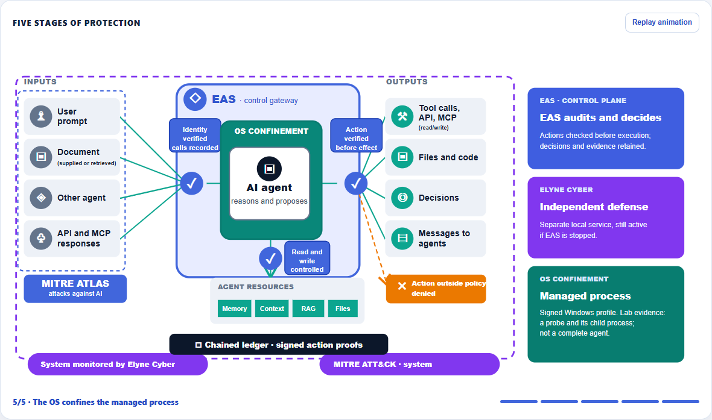

# EAS Defense

**Languages: English · [Français](README.md)**

**The agent proposes. EAS checks permissions, decides before the action, and retains evidence.**

EAS Defense is Elyne Corp’s local control plane for agentic systems. It combines identities, capabilities, a signed policy, action mediation, and a verifiable ledger. Windows **R45** is available for assisted technical evaluation. The Linux port is still undergoing laboratory qualification.

**Website:** [EAS Defense](https://elynecorp.com/eas-defense.html) · [Contact](mailto:admin@elynecorp.fr?subject=EAS%20Defense%20evaluation)

*Screenshot of the final stage of the [published animated diagram](https://elynecorp.com/eas-defense.html#architecture). It describes the architecture; measured guarantees are scoped below.*

## How it works

1. The agent proposes an action.
2. EAS checks its identity, capabilities, and the operator’s signed **SecurityPolicy**.
3. The deterministic engine allows, constrains, sends for review, or denies the action **before it takes effect**, for actions that pass through EAS.
4. The ToolBroker mediates authorized execution while EAS retains decisions and evidence.

Ledger events are **SHA-256 hash chained**, with the chain tip checked against a separate file. **Some action proofs** produced by the ToolBroker have Ed25519 and ML-DSA-65 signatures and can be verified offline using a pinned anchor and public keys. This does not imply that every ledger event carries those signatures.

## Two integration levels

| Mode | Scope |
| --- | --- |
| **Connected agent** | EAS decides and audits actions routed through its interfaces. Other paths must be connected or restricted by the environment. |
| **Managed process** | EAS launches a process specified by a signed policy under a restricted Windows profile. OS denials and a child process identity have been observed in the lab; full confinement of a third-party agent remains to be qualified. |

Elyne Cyber is a complementary local defense running as a separate service. Elyne Red Unified is **supplied with EAS** to test it within an authorized scope. Elyne Lab Director is a **separate product** that checks laboratory prerequisites and consolidates campaign results.

## Public results

| Reference | Scoped observation |
| --- | --- |
| **R43** | Direct access to a forbidden file canary was denied from a confined probe; canary integrity was checked. |
| **R44** | A targeted network connection was denied from the confined process, with a positive connectivity control. |
| **R45** | A child retained its AppContainer identity and termination was verified under EAS control. |
| **R48** | Allowed and denied file access were observed on the R42/R43 lineage after the corrected R46 laboratory installer set the ACLs, separate from the R45 candidate. |
| **P0-05, R10** | Elyne Cyber stayed active after EAS stopped. This test was not replayed on R45. |
| **Red R21B** | On an earlier Windows clone: 19/19 jobs classified as “defended”; 43/52 steps defended and **9 undetermined**. This campaign does not qualify R45. |

These tests have different scopes. None alone establishes full confinement of an entire third-party agent or protection of every path not connected to EAS. [Results and limitations](docs/evidence.en.md).

## OWASP Agentic 2026 mapping

Our internal matrix tracks **86 measures** across the ten OWASP risk categories. Every category has at least one identified mitigation; **26 measures** have directly observed, scoped validation, **47** are partial, **10** remain to be completed, and **3** depend on the deploying organization's process. These figures combine evidence from several versions through R48. They are neither an OWASP certification nor 26 validations of the same R45 build. [Read the full 86-measure mapping, rationale, and limits](docs/owasp-agentic-2026.en.md).

## Documentation

- [Architecture and trust boundaries](docs/architecture.en.md)
- [Redacted qualification summary](docs/evidence.en.md)
- [Detailed OWASP Agentic 2026 mapping](docs/owasp-agentic-2026.en.md)
- [Proprietary notice and distribution terms](NOTICE.md)

## FAQ

**Does EAS need an LLM to decide?** No. Identity checks, policy evaluation, and authorization decisions are deterministic. A model may propose or analyze; it does not grant capabilities.

**Is an existing agent fully protected as soon as it calls EAS?** No. In connected mode, EAS mediates the actions routed through it. Managed mode adds an OS boundary for the process EAS launches, subject to qualification for each target application.

**Does this repository distribute the product or grant an open-source license?** No. It is a public documentation repository. Source code, binaries, and policy rules are not distributed here; [see the notice](NOTICE.md).

To discuss integration or an assisted evaluation: [admin@elynecorp.fr](mailto:admin@elynecorp.fr) · [elynecorp.com](https://elynecorp.com).
