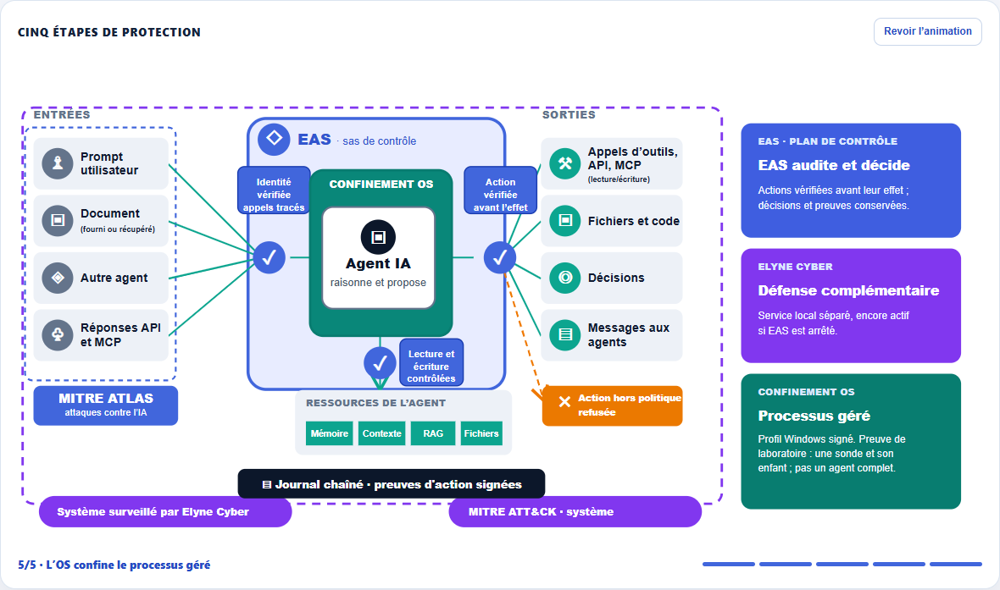

# EAS Défense

**Langues : Français · [English](README.en.md)**

**L’agent propose. EAS vérifie les droits, décide avant l’action et conserve la preuve.**

EAS Défense est le plan de contrôle local d’Elyne Corp pour les systèmes agentiques. Il associe identités, capacités, politique signée, médiation des actions et journal vérifiable. La version Windows **R45** est proposée en évaluation technique accompagnée. Le port Linux poursuit sa qualification de laboratoire.

**Site :** [EAS Défense](https://elynecorp.fr/eas-defense.html) · [Contact](mailto:admin@elynecorp.fr?subject=Evaluation%20EAS%20Defense)

*Capture de la dernière étape du [schéma animé publié sur le site](https://elynecorp.fr/eas-defense.html#architecture). Elle décrit l’architecture ; les garanties mesurées sont bornées ci-dessous.*

## Fonctionnement

1. L’agent propose une action.
2. EAS vérifie son identité, ses capacités et la **SecurityPolicy** signée de l’exploitant.
3. Le moteur déterministe autorise, contraint, soumet à revue ou refuse l’action **avant son effet**, pour les actions qui passent par EAS.
4. Le ToolBroker médie l’exécution autorisée et EAS conserve les décisions et éléments de preuve.

Le journal d’événements est **chaîné par SHA-256**, avec une tête de chaîne contrôlée contre un fichier distinct. **Certaines preuves d’action**, produites par le ToolBroker, portent des signatures Ed25519 et ML-DSA-65 et peuvent être vérifiées hors ligne avec une ancre et des clés publiques épinglées. Cela ne signifie pas que chaque événement du journal porte ces signatures.

## Deux niveaux d’intégration

| Mode | Périmètre |
| --- | --- |
| **Agent raccordé** | EAS décide et audite les actions qui empruntent ses interfaces. Les autres chemins doivent être raccordés ou limités par l’environnement. |
| **Processus géré** | EAS lance un processus prévu par une politique signée sous un profil Windows restreint. Des refus OS et l’identité d’un processus enfant ont été observés en laboratoire ; le confinement complet d’un agent tiers reste à qualifier. |

Elyne Cyber est une défense locale complémentaire dans un service séparé. Elyne Red Unifiée est **fournie avec EAS** pour éprouver le dispositif dans un périmètre autorisé. Elyne Lab Director est un **produit distinct** qui vérifie les prérequis du laboratoire et consolide les résultats de campagne.

## Résultats publiables

| Référence | Observation bornée |
| --- | --- |
| **R43** | Accès direct à un canari fichier interdit refusé depuis une sonde confinée ; intégrité du canari contrôlée. |
| **R44** | Connexion réseau ciblée refusée depuis le processus confiné, avec contrôle positif de la connectivité. |
| **R45** | Identité AppContainer d’un processus enfant conservée et arrêt vérifié sous pilotage EAS. |
| **R48** | Accès fichier permis et refusés observés sur la lignée R42/R43 après pose des ACL par l’installateur de laboratoire corrigé R46, distincte du candidat R45. |
| **P0-05, R10** | Elyne Cyber est resté actif après arrêt d’EAS. Cet essai n’a pas été rejoué sur R45. |
| **Red R21B** | Sur un clone Windows antérieur : 19/19 jobs classés « défendus » ; 43/52 étapes défendues et **9 indéterminées**. Cette campagne ne qualifie pas R45. |

Ces essais ont des périmètres distincts. Aucun n’établit à lui seul le confinement intégral d’un agent tiers complet, ni une protection de tous les chemins non raccordés. [Détail des résultats et limites](docs/evidence.md).

## Cartographie OWASP Agentic 2026

Notre grille interne suit **86 mesures** reliées aux dix catégories du référentiel OWASP. Les dix catégories ont au moins une atténuation identifiée ; **26 lignes** ont une validation directe bornée, **47** sont partielles, **10** restent à réaliser et **3** dépendent d'une organisation exploitante. Ces chiffres rassemblent des preuves de plusieurs versions jusqu'à R48 : ils ne constituent ni une certification OWASP ni 26 validations du même build R45. [Consulter les 86 mesures, leurs justifications et leurs limites](docs/owasp-agentic-2026.md).

## Documentation

- [Architecture et frontières de confiance](docs/architecture.md)
- [Synthèse expurgée des qualifications](docs/evidence.md)
- [Cartographie détaillée OWASP Agentic 2026](docs/owasp-agentic-2026.md)
- [Notice de propriété et de distribution](NOTICE.md)

## Questions fréquentes

**EAS fonctionne-t-il sans LLM ?** Oui. Le contrôle d’identité, l’évaluation de la politique et la décision d’autorisation sont déterministes. Un modèle peut proposer ou analyser ; il ne détient pas l’autorité d’accorder des capacités.

**Un agent existant est-il entièrement protégé dès qu’il appelle EAS ?** Non. En mode raccordé, seules les actions qui passent par EAS sont médiées. Le mode géré ajoute une frontière OS pour le processus lancé par EAS, à qualifier pour chaque logiciel cible.

**Ce dépôt contient-il le logiciel ou une licence open source ?** Non. Il s’agit d’une présentation documentaire publique. Le code, les binaires et les règles de politique ne sont pas distribués ici ; [voir la notice](NOTICE.md).

Pour étudier une intégration ou une évaluation accompagnée : [admin@elynecorp.fr](mailto:admin@elynecorp.fr) · [elynecorp.fr](https://elynecorp.fr).
