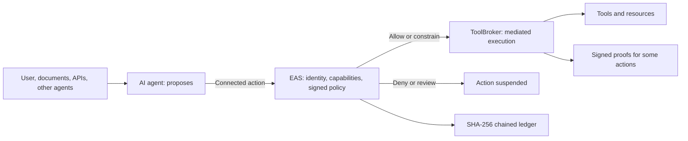

# Public architecture

[Français](architecture.md) · [Home](../README.en.md)

EAS Defense separates the **agent’s proposal**, the **authorization decision**, and **execution**. The operator defines capabilities in a signed SecurityPolicy. EAS verifies the identity and request, applies the policy deterministically, and records the decision.

The diagram shows the **connected path**. A direct call from an agent to a resource outside that path is not covered by application-level mediation alone. It must be connected or restricted by the environment.

## Managed-mode OS boundary

In managed mode, EAS launches the process designated by a signed profile under a restricted Windows identity. Laboratory tests observed an AppContainer identity, file and targeted network denials, and a child retaining that identity. These observations involve probes and separate tests. They do not automatically qualify every application or all of its dependencies and execution paths.

## Distinct components

- **Elyne Cyber** provides complementary local defense in a separate service. Test P0-05 on R10 observed that it remained active after EAS stopped. This property was not replayed on R45 and does not by itself establish complete OS privilege separation.
- **Elyne Red Unified**, supplied with EAS, runs authorized offensive scenarios against an installation. Its verdicts belong to the clone and version actually tested.
- **Elyne Lab Director** is a separate laboratory orchestration product: it checks prerequisites and scope before a campaign and consolidates results. It does not replace the EAS policy or OS boundaries.

## Evidence integrity

EAS ledger events are SHA-256 hash chained; the chain tip is checked against a separate file. **ToolBroker action proofs** on certain paths carry Ed25519 and ML-DSA-65 signatures that can be verified offline with pinned trust references. The chained ledger and signed proofs are different properties.

[Qualification summary](evidence.en.md) · [Official website](https://elynecorp.com/eas-defense.html)
