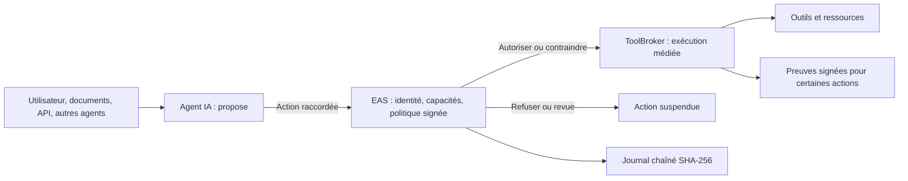

# Architecture publique

[English](architecture.en.md) · [Accueil](../README.md)

EAS Défense sépare la **proposition de l’agent**, la **décision d’autorisation** et l’**exécution**. L’exploitant définit les capacités dans une SecurityPolicy signée. EAS vérifie l’identité et la demande, applique la politique de façon déterministe et journalise la décision.

Le diagramme montre le **chemin raccordé**. Un appel direct d’un agent à une ressource hors de ce chemin n’est pas couvert par la seule médiation applicative. Son raccordement ou une restriction par l’environnement est nécessaire.

## Frontière OS du mode géré

Dans le mode géré, EAS lance le processus désigné par un profil signé sous une identité Windows restreinte. Les essais de laboratoire ont observé une identité AppContainer, des refus de fichier et de connexion ciblée, ainsi que la conservation de l’identité d’un enfant. Ces observations concernent des sondes et des essais distincts ; elles ne qualifient pas automatiquement chaque application ni l’ensemble de ses dépendances et chemins d’exécution.

## Composants distincts

- **Elyne Cyber** fournit une défense locale complémentaire dans un service séparé. L’essai P0-05 de R10 a constaté qu’il restait actif après l’arrêt d’EAS. Cette propriété n’a pas été rejouée sur R45 ; elle n’implique pas à elle seule une séparation complète des privilèges OS.
- **Elyne Red Unifiée**, fournie avec EAS, exécute des scénarios offensifs autorisés pour éprouver une installation. Ses verdicts sont rattachés au clone et à la version testés.
- **Elyne Lab Director** est un produit distinct de pilotage de laboratoire : il vérifie les prérequis et le périmètre avant une campagne et consolide les résultats. Il ne remplace ni la politique d’EAS ni les frontières OS.

## Intégrité des preuves

Les événements du journal EAS sont chaînés par SHA-256 ; la tête de chaîne est contrôlée contre un fichier distinct. Des **preuves d’action** ToolBroker, sur certains chemins, portent des signatures Ed25519 et ML-DSA-65 vérifiables hors ligne avec des références de confiance épinglées. Le journal chaîné et les preuves signées sont deux propriétés différentes.

[Synthèse des qualifications](evidence.md) · [Site officiel](https://elynecorp.fr/eas-defense.html)
